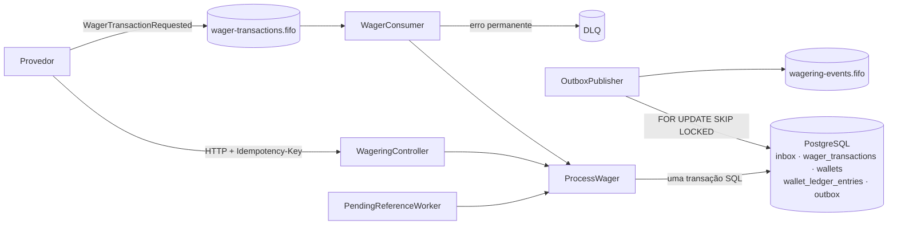

# Arquitetura e decisões

## 1. Visão geral

Um caso de uso só, `ProcessWager`, atende a API, o consumidor SQS e o worker de referências pendentes. Dentro de **uma transação SQL**:

1. registra a mensagem na inbox (quando veio da fila);
2. insere a transação com a chave de idempotência (`INSERT ... ON CONFLICT DO NOTHING`); se já existia, devolve o resultado original;
3. trava a wallet (`SELECT ... FOR UPDATE`);
4. aplica as regras de negócio no domínio, que decide e move o saldo;
5. grava a transação, o saldo, o lançamento no extrato e os eventos na outbox;
6. `COMMIT`. Só depois disso a API responde e o consumidor faz o ack (`DeleteMessage`).

Cada instância roda a API e, conforme `WORKERS`, o consumidor, o publicador da outbox e o worker de pendentes. Não há estado em memória que importe para a correção: tudo o que garante as invariantes está no banco.

## 2. Camadas

| Camada | O que tem | Depende de |
|---|---|---|
| `domain/` | `Money`, `Wallet`, `WagerTransaction`, `WalletLedgerEntry`, `settle()` (regras da seção 7), eventos, `InboxMessage`, `OutboxMessage` | nada (nem NestJS, nem ORM) |
| `application/` | casos de uso, validação de entrada, portas (`UnitOfWork`, repositórios) | domínio |
| `infrastructure/` | adaptador SQL (MikroORM), migrations, SQS, workers, logs, métricas | aplicação e domínio |
| `http/` | controllers, filtro de erros, guard de autenticação | aplicação |

As entidades seguem a regra 6.0: construtor privado, factories `create`/`open`/`from` que validam e `rehydrate` que só reconstrói o estado persistido. As regras de negócio ficam em `settle()`, uma função pura testada sem banco ([test/unit/settlement.test.ts](test/unit/settlement.test.ts)).

## 3. ORM e persistência

**MikroORM** (preferencial no desafio) cuida da conexão e do pool, das transações (`EntityManager.transactional()`) e das **migrations versionadas e reversíveis**. Os repositórios usam **SQL explícito** por `em.execute()`, dentro da transação do `transactional()`, em vez de entidades mapeadas. Motivos:

- **Travas e condições precisas.** A correção depende de `FOR UPDATE`, `ON CONFLICT DO NOTHING`, `FOR UPDATE SKIP LOCKED` e de updates condicionados à `version`. Em SQL explícito, cada garantia está escrita onde pode ser lida.
- **Domínio puro.** As classes do domínio não têm decorators de ORM e são reconstruídas por `rehydrate`. Um Identity Map/Unit of Work em cima delas exigiria mapear campos privados e construtores privados, ganhando pouco: cada caso de uso grava poucas linhas, conhecidas.
- **Trade-off assumido.** Sem o change tracking do ORM, o repositório decide o que gravar. O preço é escrever os `UPDATE`s à mão; em troca não há flush implícito em momento inesperado.

**Mapeamento do `Money`.** No banco, valor em `NUMERIC(18,2)` e moeda em `CHAR(3)` (colunas separadas, representação exata). O driver devolve o `NUMERIC` como string, que vira `Money` (centavos em `bigint`). Nunca passa por `number`.

As migrations estão listadas explicitamente na configuração (`migrationsList`), sem varrer a pasta: funciona igual no macOS, no Linux e no container. Cada migration nova criada com `bun run db:migration` precisa ser adicionada a essa lista.

## 4. Concorrência

**A unidade de concorrência é a wallet.** Estratégia: **trava pessimista por linha** (`SELECT ... FOR UPDATE` na wallet), no isolamento padrão do PostgreSQL (READ COMMITTED), com transações curtas.

- **Sem lock global.** Wallets diferentes processam em paralelo; só operações da mesma wallet fazem fila.
- **Nada de read → calculate → update solto.** O saldo é lido sob a trava e gravado com `WHERE id = ? AND version = ?` (a `version` esperada é uma segunda proteção contra lost update; com a trava, nunca falha).
- **Idempotência antes da trava.** O `INSERT ... ON CONFLICT DO NOTHING` na chave acontece antes de travar a wallet. Cinquenta cópias da mesma aposta esperam o commit da primeira no índice único e viram replay, sem disputar a wallet.
- **Deadlock e falha de serialização** desfazem a transação inteira; ela é repetida até 3 vezes com espera aleatória.
- **`lock_timeout` de 5 s.** Ninguém espera uma trava para sempre. Passou disso, a API responde **503 com `Retry-After`**, e a fila devolve a mensagem com backoff.

**Por que pessimista, e não otimista.** Wallets quentes (muitas apostas na mesma) são o caso normal num cassino. Com locking otimista, cada conflito vira um retry, e sob disputa os retries se multiplicam. A trava por linha forma uma fila justa e dá resultado determinístico ao cenário obrigatório: com saldo 100.00 e duas apostas de 80.00, a segunda sempre vê 20.00 e é rejeitada. O custo é que a vazão de uma única wallet fica limitada pelo tempo em que a trava é segurada (ver seção 13).

**Múltiplas instâncias.** Como a trava e a unicidade estão no banco, três ou mais instâncias são equivalentes a três conexões. O teste `4. três instâncias` sobe três processos `bun` separados e manda cada aposta duas vezes, para instâncias diferentes.

## 5. Garantias no schema

Aplicadas pelo PostgreSQL, não só pelo código ([migration](src/infrastructure/database/migrations/Migration20261110230000_schema_inicial.ts)). [test/integration/schema.test.ts](test/integration/schema.test.ts) tenta violar cada uma por SQL direto.

| Garantia | Como |
|---|---|
| saldo nunca negativo | `CHECK (balance >= 0)` em `wallets`; `CHECK (balance_after >= 0)` no extrato |
| uma wallet por player + moeda | `UNIQUE (player_id, currency)` |
| idempotência persistente | `UNIQUE (idempotency_key)` e `UNIQUE (provider_id, external_transaction_id)` |
| no máximo um lançamento por transação | `UNIQUE (transaction_id)` no extrato |
| lançamento aritmeticamente correto | `CHECK` com `balance_after = balance_before ± amount` conforme a direção |
| extrato encadeado | trigger: o `balance_before` de um lançamento é o `balance_after` do anterior da mesma wallet |
| saldo da wallet = extrato | constraint trigger **deferida** (`DEFERRABLE INITIALLY DEFERRED`): no commit, o saldo tem que ser o `balance_after` do último lançamento |
| extrato imutável | triggers recusam `UPDATE`, `DELETE` e `TRUNCATE` |
| `version` sobe 1 só quando o saldo muda | trigger `BEFORE UPDATE` |
| reversão única | índice único parcial em `reference_transaction_id` onde `kind IN ('REFUND','ROLLBACK') AND status = 'PROCESSED'` |
| transação terminal não muda; nenhuma é apagada | trigger `BEFORE UPDATE OR DELETE` |
| REFUND/ROLLBACK com referência; kind e status válidos; `failure_code` só em REJECTED/FAILED | `CHECK`s |

## 6. Idempotência

- **Fonte da verdade:** o header `Idempotency-Key` (na fila, `data.idempotencyKey`). Padrão recomendado: `"{providerId}:{externalTransactionId}"`.
- **`payloadHash`:** SHA-256, em hexadecimal, do **JSON canônico** (chaves ordenadas em todos os níveis, campos ausentes omitidos) dos campos de negócio: `providerId`, `externalTransactionId`, `playerId`, `walletId`, `roundId`, `gameId`, `kind`, `money` e `referenceExternalTransactionId`. A chave, o `messageId`, o `occurredAt` e o `correlationId` ficam de fora. O valor é normalizado antes do hash, então `"25.5"` e `"25.50"` são o mesmo pedido. UUIDs são normalizados em minúsculas.
- **Mesma chave, mesmo hash:** devolve o **resultado original**, com o saldo observado naquele momento (`observed_balance`) e `idempotentReplay: true`. O status HTTP é o mesmo da primeira resposta.
- **Mesma chave, outro hash:** `409 IDEMPOTENCY_KEY_CONFLICT`. Mesmo `(providerId, externalTransactionId)` com outra chave: `409 EXTERNAL_ID_CONFLICT`. Nos dois casos nada é gravado.
- **Inbox:** deduplicação por `(consumerName, messageId)` na mesma transação do efeito. O hash da inbox considera `type` e `data` (uma reentrega com outro `occurredAt` continua sendo a mesma mensagem); mesmo `messageId` com outro conteúdo vai para a DLQ (`MESSAGE_ID_CONFLICT`).

## 7. Regras de negócio e interpretações adotadas

A tabela da seção 7 do desafio está em `settle()`. Onde o enunciado deixava espaço, adotei:

1. **Reversão única, somando REFUND e ROLLBACK.** O enunciado proíbe reverter duas vezes "pelo mesmo tipo de operação". Fui mais estrito: uma referência aceita **uma** reversão processada, de qualquer tipo. Do contrário, um REFUND e um ROLLBACK da mesma BET devolveriam o valor duas vezes. Desfazer um REFUND continua possível: o ROLLBACK referencia o próprio REFUND.
2. **WIN e LOSS podem referenciar a BET da rodada** (opcional). Se referenciam, a referência é validada como as outras (mesmo provider, player, wallet, moeda e rodada). BET não referencia nada.
3. **Valor maior que zero** em BET, WIN, REFUND e ROLLBACK; LOSS aceita zero (registra o resultado sem mover saldo).
4. **Referência ainda pendente conta como ausente.** Um ROLLBACK de um WIN que está esperando a própria BET também espera.
5. **Replay de uma pendente devolve o estado atual.** Para transações terminais, o replay é o resultado original. Para `PENDING_REFERENCE`, devolve o que ela é agora: se já foi processada, `200 PROCESSED`.
6. **Wallet de outro player:** `REJECTED / WALLET_PLAYER_MISMATCH`, sem expor o saldo daquela wallet.
7. **`FAILED`:** usado quando o reprocessamento de uma pendente encontra um erro inesperado e não transitório, para não tentar para sempre e deixar a transação auditável.
8. **`OPENING`:** criado só junto com a wallet, com `providerId = "internal"` e chave `opening:{walletId}`. A API e a fila recusam `OPENING`.
9. **ROLLBACK que deixaria saldo negativo:** `ROLLBACK_INSUFFICIENT_FUNDS`, distinto de `INSUFFICIENT_FUNDS`.

## 8. Referências fora de ordem

A transação sem referência é gravada como `PENDING_REFERENCE` (HTTP 202) com `next_attempt_at`. O **worker** busca as vencidas, trava cada uma com `FOR UPDATE SKIP LOCKED` (duas instâncias nunca tratam a mesma) e reaplica as regras.

- **Backoff exponencial:** 1 s, 2 s, 4 s... (`PENDING_BASE_DELAY_MS × 2^n`). **Limite: 8 tentativas, cerca de 4 minutos.** Na prática, provedores mandam o resultado e o estorno da rodada em segundos. Quatro minutos cobrem atrasos de fila e retries do provedor sem deixar uma reversão órfã pendurada por horas.
- **Antecipação:** quando uma transação termina, as pendentes que a referenciam têm a próxima tentativa antecipada para agora. Isso roda **depois do commit**, fora da transação, para não segurar a trava da wallet e porque só então a referência está visível.
- **Esgotado o limite:** `REJECTED / REFERENCE_NOT_FOUND` e evento `WagerTransactionRejected`.

## 9. Mensageria (SQS)

- **Filas FIFO**, com `MessageGroupId = walletId`: a ordem por wallet é preservada pelo broker. Isso é otimização. A garantia final é do banco (idempotência e trava), então a correção não depende de a SQS entregar uma vez só.
- **Consumidor:** recebe até 10 mensagens; grupos diferentes em paralelo, cada grupo em ordem. Usa o **mesmo caso de uso** da API. **Ack só depois do commit.**

| Situação | Tratamento |
|---|---|
| processada, rejeitada por regra ou já vista na inbox | ack (`DeleteMessage`) |
| payload inválido, `OPENING`, conflito de idempotência ou de `messageId` | **permanente:** cópia para a DLQ com `reason`, depois ack |
| falha transitória (banco fora, lock timeout, deadlock esgotado) | sem ack; `ChangeMessageVisibility` com backoff (`base × 2^(n-1)`, até 5 min) |
| tentativas esgotadas | a **redrive policy** (`maxReceiveCount = 5`) move para a DLQ |
| processo morre depois do commit e antes do ack | a mensagem volta depois do visibility timeout; a inbox reconhece; ack sem efeito duplicado |

- **`SIGTERM`:** o consumidor para de buscar (aborta o long polling), termina as mensagens em andamento e devolve à fila (`VisibilityTimeout = 0`) as que ainda não começaram. O pool do banco fecha por último.

## 10. Transactional Outbox

Os eventos são gravados em `outbox_messages` **na mesma transação** da mudança. O **publicador** roda em cada instância:

1. numa transação, trava até 10 eventos vencidos com `FOR UPDATE SKIP LOCKED`;
2. publica na fila de eventos (`SendMessageBatch`);
3. marca os aceitos como publicados e reagenda os outros com backoff; commit.

**Janelas de falha:**
- O commit da transação financeira aconteceu e o processo morreu antes de publicar: o evento está na outbox, e outra instância publica.
- Publicou e morreu antes do commit da marcação: o evento é publicado de novo. Quem consome os eventos deve deduplicar pelo `eventId`; a fila FIFO também descarta duplicatas com o mesmo `MessageDeduplicationId` em 5 minutos.
- **Vários publicadores:** `SKIP LOCKED` faz cada um pegar linhas diferentes. O teste `6. dois publishers` conta as publicações de cada evento: exatamente uma.

**Eventos:** `WagerTransactionProcessed` (inclusive LOSS), `WagerTransactionRejected`, `WalletBalanceChanged` (só quando o saldo muda, inclusive na abertura com saldo) e `WagerTransactionPendingReference`. O envelope é uma classe abstrata (`IntegrationEvent`) com uma subclasse por evento; tipo e versão ficam na classe. `data` carrega `MoneyProps`, nunca a instância de `Money`. O `aggregateId` de todos é a wallet, também usada como `MessageGroupId`.

**Ordem:** com vários publicadores, eventos da mesma wallet podem sair fora de ordem entre lotes. Por isso o `WalletBalanceChanged` carrega `walletVersion`: quem consome deve ignorar versões mais antigas que a última vista.

## 11. Observabilidade

- **Logs estruturados (JSON),** uma linha por evento, com `correlationId`, `messageId`, `transactionId`, `walletId`, `providerId`, `status` e `failureCode`. Sem payloads nem valores monetários. O `correlationId` vem do header `x-correlation-id` (ou é gerado), volta na resposta e segue nos eventos. Na fila, é o `correlationId` da mensagem ou o `messageId`.
- **Métricas** (`GET /metrics`, Prometheus):
  - `wagering_transactions_total{status,kind}`;
  - `wagering_duplicates_total{source}`: replay por chave ou inbox;
  - `wagering_retries_total{source}`;
  - `wagering_dlq_messages_total{reason}`;
  - `wagering_lock_conflicts_total{reason}`: deadlock, serialização ou lock timeout;
  - `wagering_outbox_lag_seconds`: idade do evento pendente mais antigo;
  - `wagering_processing_duration_seconds{source}`;
  - `wagering_reconciliation_divergences_total`.
- **Health:** `/health/live` (processo vivo) e `/health/ready` (PostgreSQL e SQS respondem), sem autenticação.
- **Reconciliação:** saldo guardado e soma do extrato são lidos num **único comando SQL** (mesmo snapshot). Divergência é logada como erro, contada em métrica e sinalizada na resposta; nunca é corrigida em silêncio.

## 12. Autenticação (não implementada)

Ela não vale pontos e competiria com o núcleo financeiro pelo tempo disponível, então ficou de fora. O ponto de extensão está no código: [`ProviderAuthGuard`](src/http/support.ts), aplicado aos controllers de wallets e de transações, que hoje deixa passar.

Desenho previsto:
- **IdP externo:** Keycloak ou Zitadel no Compose, com um client por provedor no fluxo OAuth2 *client credentials*.
- **No guard:** validar o JWT pelo JWKS do IdP (assinatura, `iss`, `aud`, expiração) e mapear o `client_id` para o `providerId`.
- **No caso de uso:** exigir que o `providerId` do payload seja o do token, senão 403. Isso fica numa `ProviderIdentityPort`, para o domínio não conhecer JWT.
- **Fora da autenticação:** health e métricas ficam abertos. A fila é canal interno confiável, mas o `providerId` da mensagem continua sujeito às validações de domínio (referência do mesmo provider etc.).

## 13. Testes

Rodam contra **PostgreSQL e LocalStack reais**, em containers. Não há mock de banco nem de fila. Total: **111 testes**.

| Suíte | Cobre |
|---|---|
| `unit/` (64) | `Money` (escala, sem arredondamento, entradas inválidas, moedas), `Wallet` e extrato, regras de BET/WIN/LOSS/REFUND/ROLLBACK, conflito de moeda, transições terminais, payload divergente na mesma chave, envelope de eventos, backoff da outbox |
| `integration/schema` | migrations up/down/up; cada constraint e trigger da seção 5, violada por SQL direto |
| `integration/atomicity` | falha simulada na última etapa (outbox): nada fica gravado — wallet, extrato, transação, inbox |
| `integration/api` | contrato HTTP, status distintos, replay idêntico, paginação do extrato, reconciliação, health e métricas |
| `integration/messaging` | inbox e reentrega, API e fila com a mesma chave, DLQ de mensagem inválida, retry até a DLQ pela redrive policy, outbox até a fila de eventos |
| `concurrency/` | os 8 cenários obrigatórios: mesma aposta 50× em paralelo; 100.00 com 80+80 (em 20 wallets ao mesmo tempo) e wallet quente; wallets distintas em paralelo; **3 processos** (API e fila); worker morto depois do commit e antes do ack; dois publishers sobre a mesma outbox; REFUND/ROLLBACK antes da referência; **kill -9** no meio da carga e reinício |

Invariante conferida ao fim dos testes de concorrência: `wallet.balance == saldo reconstruído pelo extrato`, com o extrato encadeado do primeiro ao último lançamento.

O teste "worker morto depois do commit" reproduz exatamente o estado da falha: commit feito, mensagem sem ack, visibilidade devolvida. Ele não mata o processo; o teste de reinício é que usa `SIGKILL` de verdade.

## 14. Teste de carga

`bun run test:load` sobe 3 instâncias, cria 50 wallets "frias" e uma "quente" e dispara apostas por um tempo fixo com N clientes concorrentes, alternando entre as instâncias. Ao fim, mede o atraso da outbox até zerar e confere a invariante em todas as wallets. Parâmetros: `LOAD_SECONDS`, `LOAD_CONCURRENCY`, `LOAD_HOT_RATIO`, e `LOAD_URLS` para usar instâncias já rodando (ex.: as réplicas do Compose).

**Ambiente:**
- MacBook Air Intel Core i5-1030NG7 (1,1 GHz, 4 núcleos), 8 GB de RAM.
- Docker Desktop com uma VM de 2 vCPUs e 4 GB, onde rodam PostgreSQL e LocalStack.
- Gerador de carga e aplicação na mesma máquina.

**Resultados** (30 clientes concorrentes, 3 instâncias):

| Cenário | Vazão | p50 | p95 | p99 | Erros | Conflitos de trava | Outbox |
|---|---|---|---|---|---|---|---|
| todas as apostas em 50 wallets, 20 s | 39 req/s | 696 ms | 1.232 ms | 1.581 ms | 0% | 0 | lag máx. 14,8 s; zerou 7 s depois |
| 50% numa wallet quente, 20 s | 16 req/s | 501 ms | 8.013 ms | 14.221 ms | 0% | 0 | lag máx. 4,0 s; zerou 0,1 s depois |
| 50 wallets, réplicas no Docker, 12 s | 35 req/s | 777 ms | 1.611 ms | 1.858 ms | 0% | 0 | zerou 3,2 s depois |

A invariante saldo = extrato passou em todas as wallets, em todas as rodadas.

**Análise.** Os números medem sobretudo o ambiente. Medições isoladas:
- **Uma ida e volta ao banco** custa cerca de **4,5 ms** nesta máquina (50 transações seguidas com 8 `SELECT 1` levam 45 ms cada).
- **Uma aposta** faz 9 idas e voltas dentro da transação (`BEGIN`, `lock_timeout`, insert idempotente, trava, transação, wallet, extrato, outbox e `COMMIT`), mais 1 depois do commit (antecipar pendentes). Isolada, leva 35–45 ms.
- **Durante a carga,** o PostgreSQL ficou em ~35% de CPU e com a maioria das conexões ociosas, esperando o cliente (`ClientRead`).
- **A rede do Docker Desktop foi descartada:** com as réplicas dentro do Docker, a vazão foi a mesma.

O teto vem de latência por comando numa máquina pequena, com 2 vCPUs para banco, LocalStack e aplicação, e não de disputa por trava (zero conflitos).

**A wallet quente** mostra o custo da trava pessimista. As apostas nela são serializadas, e a vazão de uma wallet fica limitada a ~1 / (tempo com a trava). Aqui a trava dura ~6 idas e voltas (da trava ao `COMMIT`), cerca de 27 ms, ou seja, ~35 apostas/s por wallet. O p95 alto da wallet quente é fila, não erro. Se a espera passasse de 5 s, a resposta seria 503 com `Retry-After`. Nenhuma transação ficou inconsistente.

**O que eu faria a seguir:**
1. **Encurtar a trava:** gravar transação, saldo, extrato e outbox num único comando (CTE com `UPDATE`/`INSERT` encadeados). A trava cairia de ~6 para ~3 idas e voltas, dobrando a vazão por wallet.
2. **Pré-aquecer o pool** de conexões.
3. **Medir num Linux**, com PostgreSQL nativo e o gerador de carga em outra máquina.
4. **Para wallets muito quentes,** encaminhar as operações de uma wallet a um único consumidor (o `MessageGroupId` já agrupa por wallet), trocando a espera na trava por ordem na fila.

## 15. Limitações e trade-offs

- **Autenticação** não implementada (seção 12).
- **Moeda única nos testes de fluxo (BRL).** O modelo é multi-moeda, e os conflitos de moeda são testados.
- **Ledger de partida simples,** não de partidas dobradas (diferencial opcional não feito).
- **Ordem entre lotes da outbox** depende de quem consome os eventos usar o `walletVersion` (seção 10).
- **LocalStack fixado em 4.14.0,** por causa da licença das versões novas. O MiniStack seria a alternativa.
- **OpenTelemetry e dashboard** (opcionais) não foram feitos; os logs e métricas cobrem o diagnóstico pedido.

## 16. Uso de IA

O projeto foi desenvolvido com apoio de IA (Claude, da Anthropic) como par de programação. As decisões acima estão documentadas para serem discutidas na apresentação.
